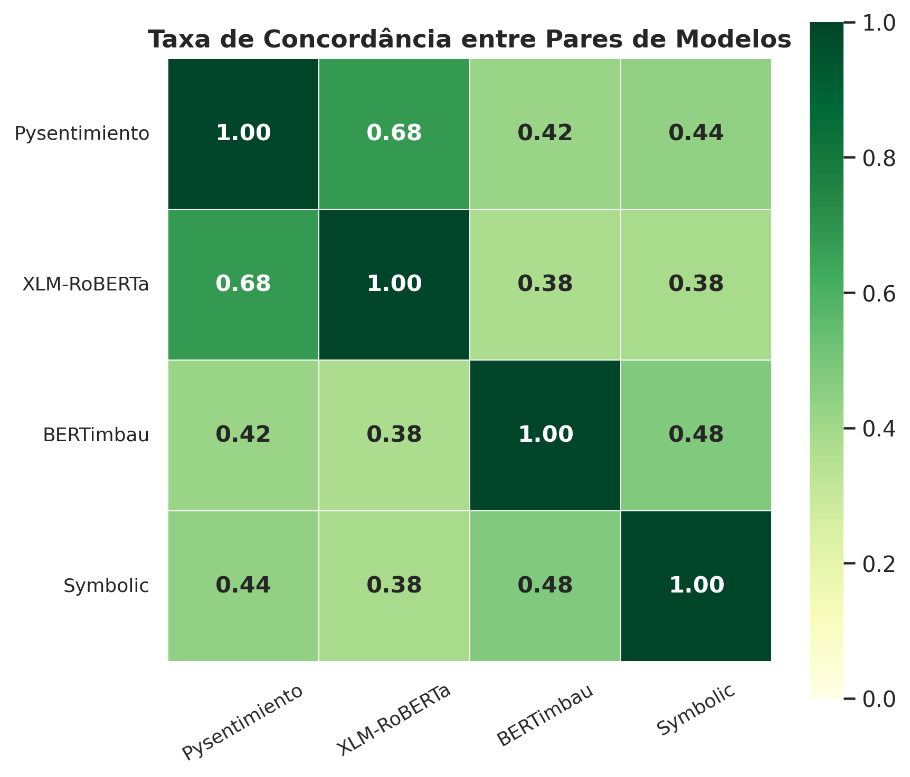

<div align="center">

# Detecção de apoio em comentários de saúde mental com BERTimbau

### BERTimbau ajustado num dataset próprio, anotado à mão, detecta apoio em comunidades de saúde mental com 50% mais F1 que os modelos prontos.


</div>

*English summary at the end.*

| **0,598** | **+0,20** | **2.995** | **0,105 → 0,041** |
|:---:|:---:|:---:|:---:|
| F1-macro do ensemble no teste humano | de F1 sobre o melhor modelo pronto (0,399) | comentários anotados pela equipe | erro de calibração (ECE) com temperature scaling |

Classificação de comentários em comunidades brasileiras de saúde mental no Reddit (`r/AnsiedadeDepressao` e `r/desabafos`) em três classes:

| Classe | Significado |
|---|---|
| **B** (apoio) | acolhe, encoraja, demonstra empatia |
| **N** (neutro) | informa, pergunta ou relata sem carga emocional |
| **M** (não-apoio) | minimiza o sofrimento, é hostil ou ofensivo |

O projeto cobre o pipeline inteiro: **coleta, anotação humana de um dataset próprio**, um sistema simbólico baseado em léxico, **fine-tuning do BERTimbau** e comparação com modelos prontos do estado da arte.

## Resultados (300 comentários de teste rotulados por humanos)

| Modelo | Acurácia | **F1-macro** | F1-ponderado |
|---|---|---|---|
| BERTimbau, holdout | 0,620 | 0,574 | 0,634 |
| BERTimbau, K-Fold (média ± dp) | 0,648 ± 0,019 | 0,578 ± 0,016 | 0,652 ± 0,013 |
| **BERTimbau, ensemble final** | **0,667** | **0,598** | **0,671** |
| Pysentimiento (pronto, zero-shot) | 0,427 | 0,399 | 0,444 |
| XLM-RoBERTa cardiffnlp (pronto, zero-shot) | 0,377 | 0,358 | 0,382 |

- O modelo ajustado no domínio ganha **+0,20 de F1-macro** sobre o melhor modelo pronto.
- F1 por classe: apoio 0,77, neutro 0,66, **não-apoio 0,36**. A classe minoritária (~12% dos dados) é a parte difícil.
- **Calibração:** temperature scaling reduziu o erro de calibração (ECE) de 0,105 para 0,041.



## Pipeline
1. **Coleta** (notebook 01): comentários via PRAW e dumps do Pushshift; remoção de respostas do próprio autor, bots, removidos e textos curtos; normalização (emojis em texto, Markdown removido).
2. **Anotação humana:** 3.000 comentários amostrados de forma estratificada (2.995 válidos), divididos entre 6 anotadores com guia e planilhas de rótulo restrito.
3. **Sistema simbólico** (notebook 01): normalização com SymSpell e spaCy, léxicos OpLexicon e SentiLex, regras de negação e intensificação.
4. **BERTimbau** (notebook 02, `neuralmind/bert-base-portuguese-cased`):
   - **TAPT:** pré-treino MLM nos ~10 mil comentários sem rótulo (perplexidade 8,38 → 6,00).
   - **Focal loss** (γ=2) com pesos de classe; lr 2e-5, batch 16, 2 épocas, warmup 10%.
   - **K-Fold estratificado (k=5)** e **ensemble** pela média dos logits.
   - **Temperature scaling** calibrado nas predições out-of-fold.
5. **Avaliação:** comparação no teste humano e análise de concordância entre 4 modelos em 10.476 comentários sem rótulo.

## Como reproduzir
```bash
pip install -r requirements.txt
```
- Rode `notebooks/02_bertimbau_finetuning.ipynb` no Google Colab com GPU. Os dados processados são baixados via `gdown` pelo próprio notebook.
- A tabela de comparação no teste humano é gerada por [`src/comparacao_modelos_referencia.py`](src/comparacao_modelos_referencia.py) (célula a ser executada após a Parte 3 do notebook).
- As saídas dos notebooks foram removidas deste repositório porque exibiam comentários de pessoas em comunidades de saúde mental. Os resultados estão nesta página e no [relatório](report/relatorio.pdf).

## Ética e limitações
- **Privacidade:** os comentários vêm de comunidades de pessoas em sofrimento. Nenhum texto ou nome de usuário é publicado aqui, e o autor foi descartado antes da anotação.
- **Uso pretendido:** pesquisa sobre dinâmica de apoio em comunidades online. **Não deve ser usado** para moderação automática nem para qualquer decisão clínica: com F1 de 0,36 na classe de não-apoio, o modelo erraria muito justamente no caso mais sensível.
- **Rótulos:** cada comentário tem um único anotador, e a concordância entre anotadores (kappa) não foi medida.
- Truncamento das entradas e viés de plataforma (Reddit) limitam a generalização.

## Estrutura
```
├── notebooks/
│   ├── 01_coleta_e_sistema_simbolico.ipynb
│   └── 02_bertimbau_finetuning.ipynb
├── src/comparacao_modelos_referencia.py
├── figures/
└── report/relatorio.pdf
```

## Autores
Projeto em grupo de 6 integrantes na disciplina de Processamento de Linguagem Natural (ICMC/USP, 2026), incluindo **Renato Calacina Spessotto**.
<!-- TODO: listar os nomes de todos os integrantes antes de publicar. -->

---

## English summary
Classifies Brazilian Portuguese Reddit comments in mental-health communities as supportive, neutral or non-supportive, using a **dataset collected and annotated by the team** (2,995 comments). BERTimbau with task-adaptive pretraining, focal loss, a 5-fold ensemble and temperature scaling reaches **macro-F1 0.598 vs. 0.399** for the best off-the-shelf model (Pysentimiento), with calibration error reduced from 0.105 to 0.041. Not intended for automated moderation or clinical use.
